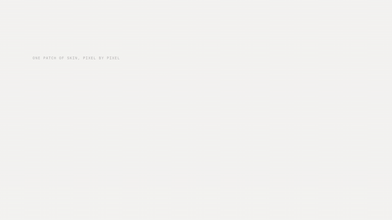

# Skin Tone Color Match

Upload a photo, click an evenly lit patch of skin, and get the closest of 56
reference skin tones plus colors to wear in five families: warm, bright, dark,
pastel and metallic.



[Download the demo with sound (MP4, 0.7 MB)](https://github.com/AryanVault/tonalyze/raw/main/docs/demo.mp4)

No photo handy? **Try a sample photo** on the start screen loads a synthetic
image with three skin tones under side light. Photos are processed in memory
and never saved to disk.

## Run it

```
python -m venv venv
venv\Scripts\activate            # macOS/Linux: source venv/bin/activate
pip install -r requirements.txt
streamlit run app.py
```

## How the match works

- **Sampling.** The app takes the median color of a square around the click.
  Fine, Medium and Wide cover 1%, 2.5% and 5% of the photo's short side. A
  single pixel is too noisy to trust: in testing, one-pixel readings of the
  same skin landed on up to 9 different tones, while a 15 px median landed on 1.
- **Matching.** Colors are compared in CIELAB (CIE76 delta E), which tracks how
  different two colors look far better than raw RGB. Delta E up to 5 is shown
  as a close match, up to 12 as approximate. Above that, the spot is probably
  in shadow, shiny, or not skin.
- **Lighting matters more than anything else.** Daylight near a window, no
  flash, no filters.

The page is deliberately neutral grey and ink. Color-matching booths use a
neutral surround for the same reason: a tinted background shifts how the skin
and swatches look.

## Data: `colors.csv`

One row per tone: `Skin Tone Name`, `HEX Code`, `Red`, `Green`, `Blue`, then
five `Recommended Colors (...)` columns. Each of those holds five entries
written `Name (#RRGGBB)`, separated by commas.

The app refuses to start on a malformed entry and names the tone and category.
`tests/test_colors_csv.py` also checks that:

- tone names are unique and `HEX Code` matches the RGB columns
- every category lists five different colors
- each hex code has one name, and each name one hex code
- "Dark" picks are actually dark
- the tones run from very fair to very deep skin

Porcelain, Fair Ivory, Fair Beige, Ebony and Deep Ebony use hex values from
the [Monk Skin Tone Scale](https://skintone.google) (MST 1-3 and 9-10). Their
recommendations are drawn from colors already in the file and are worth a
second look by someone with a styling eye.

## Tests

```
pip install -r requirements-dev.txt
pytest
```

## Deploy

The app runs on [Streamlit Community Cloud](https://streamlit.io/cloud) for free:

1. Push this repo to GitHub.
2. Sign in to Streamlit Community Cloud with GitHub and create a new app from
   this repo, pointing it at `app.py` on your default branch.
3. In the advanced settings, pick Python 3.13 (what the pinned versions are
   tested on).

Every push redeploys. Free apps go to sleep when nobody visits and take about
a minute to wake up; the demo video above covers that gap.

`requirements.txt` uses `opencv-python-headless` on purpose: Linux cloud hosts
have no desktop graphics libraries, and the regular `opencv-python` wheel fails
to import there.

## Files

| File | What it holds |
|---|---|
| `app.py` | The Streamlit page |
| `skin_tone.py` | Sampling, color math and CSV loading (no Streamlit) |
| `components.py` | HTML for the readout, tone ruler and paint strips |
| `style.css`, `.streamlit/config.toml` | Look and theme |
| `samples/sample.jpg` | Synthetic sample photo (regenerate with `samples/make_sample.py`) |
| `docs/` | Demo as an inline GIF and as an MP4 with sound |
| `tests/` | The test suite |

## Known limits

- Picking a spot needs a mouse or touch; the click component has no keyboard
  equivalent.
- Resizing the browser window after a photo loads can leave a gap under the
  photo until the next click (the click component only measures itself on load).
